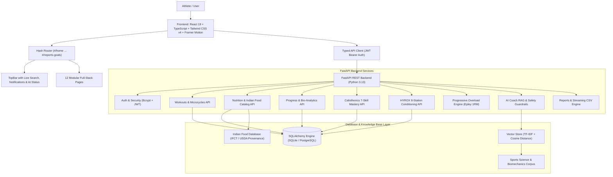

# KRIDA AI: Intelligent Fitness & Sports Platform

[](https://github.com)
[](https://fastapi.tiangolo.com)
[](https://react.dev)
[](https://tailwindcss.com)
[](https://github.com)
[](LICENSE)

> **KRIDA AI** is a production-grade Generative AI fitness, sports conditioning, and athletic intelligence platform. Designed as a comprehensive college Generative AI capstone project, KRIDA demonstrates end-to-end AI integration, persistent database storage, progressive overload biomechanics, sports science RAG retrieval, and full responsive dark SaaS dashboard design.

---

## 1. Core Architecture



---

## 2. All 12 Sections Implemented End-to-End

Every numbered item navigates to its own dedicated, responsive, stateful route with refresh persistence via URL hash routing (`#/<tabId>`):

| # | Section | Key Features & Implementation | Route |
|---|---|---|---|
| **01** | **Home** | Hero banner with exact brand copy, quick-start discipline selector (Gym, Calisthenics, HYROX), today's scheduled workout preview, weekly activity summary, recent PRs, profile onboarding alert. | `#/home` |
| **02** | **Dashboard** | 5 data-driven metric cards (Workouts Completed, Volume Tonnage, Consistency %, Est. Duration, Goal Progress), weekly volume bar chart, recent workouts, personal bests, upcoming sessions. Zero fabricated statistics. | `#/dashboard` |
| **03** | **Gym Training** | Searchable & filterable exercise catalog, preset splits (Push/Pull/Legs, Upper/Lower, Full Body), custom workout creator, live set/rep/weight logging modal, biomechanical substitution advisor. | `#/gym-training` |
| **04** | **Calisthenics** | All 7 progressions (Push-ups, Pull-ups, Dips, Handstands, L-sits, Front Levers, Muscle-ups), hold duration and repetition milestones, regressions, prerequisites, live database tracking. | `#/calisthenics` |
| **05** | **HYROX Training** | All 8 race stations (SkiErg, Sled Push, Sled Pull, Burpee Broad Jumps, Rowing, Farmers Carry, Sandbag Lunges, Wall Balls) with home gym substitutions, 4 session templates (Aerobic Base, Strength Endurance, Intervals, Recovery), distance/load/rounds/rest tracking. | `#/hyrox` |
| **06** | **AI Workout Plan** | Multi-variable profile and plan generation form (age, experience, goals, days/week, duration, equipment, injuries), individualized 7-day microcycle schedule, warm-up, cool-down, progression guidelines, engine attribution banner. | `#/workout-plan` |
| **07** | **Diet & Nutrition** | Daily macronutrient targets (TDEE Mifflin-St Jeor), meal breakdown logger (Breakfast, Lunch, Dinner, Snack), verified Indian food database (22 staple foods with stated serving sizes and IFCT/USDA provenance), AI/deterministic meal suggestions, allergen warnings. | `#/nutrition` |
| **08** | **Progress Tracker** | Date-stamped biometrics (body weight, circumference notes), Epley 1RM compound lift trends (Bench, Squat, Deadlift), 5K run pace tracking, calisthenics milestones summary, date-range filtering, delete actions, privacy policy. | `#/progress` |
| **09** | **Progressive Overload** | Previous vs current session side-by-side comparison, Epley 1RM formula, double-progression protocol, interactive overload simulator with pain flags (sharp pain immediately halts load increases), mandatory user confirmation ("Accept Progression" / "Keep Current Load"), deload reminders. | `#/progressive-overload` |
| **10** | **AI Fitness Coach** | Conversational athletic coach with user chat history in database, RAG evidence citations, per-user rate limiting (20 req/min), medical emergency guardrails (chest pain, syncope, acute injury detection with immediate physician advisory). | `#/aicoach` |
| **11** | **Equipment Finder** | 3 environment presets (Pure Bodyweight, Home Gym, Commercial Gym), granular gear checkboxes, floor space selector, real-time catalog matching, scientific explanations of why each movement fits. Zero fabricated retail commerce. | `#/equipment-finder` |
| **12** | **Reports & Goals** | Measurable goal creator with progress percentage, summary analytics (workouts, volume, consistency, recovery), compiled AI athletic diagnostic dossier, one-click printable report (`window.print()`), real streaming CSV export. | `#/reports-goals` |

---

## 3. Verified Indian Food Database & Nutrition Provenance

KRIDA AI includes a transparent, verified database of Indian staple foods with declared serving sizes, macro splits, and provenance citations:

| Food Item | Typical Serving | Calories | Protein | Carbs | Fat | Provenance Source |
|---|---|---|---|---|---|---|
| **Cooked Basmati Rice** | 1 bowl / 150g | 195 kcal | 4.1g | 43.5g | 0.4g | ICMR-NIN IFCT 2017 (Code: A001) |
| **Dal Tadka (Yellow Lentils)** | 1 medium bowl / 200g | 220 kcal | 13.5g | 28.0g | 6.2g | ICMR-NIN IFCT 2017 (Code: B004) |
| **Whole Wheat Roti / Chapati** | 1 medium roti / 40g | 120 kcal | 3.8g | 24.2g | 0.9g | ICMR-NIN IFCT 2017 (Code: A012) |
| **Fresh Paneer (Cottage Cheese)** | 100g raw | 265 kcal | 18.3g | 3.2g | 20.8g | ICMR-NIN IFCT 2017 (Code: J008) |
| **Curd / Dahi (Plain Whole Milk)** | 1 cup / 200g | 140 kcal | 6.8g | 9.4g | 8.2g | ICMR-NIN IFCT 2017 (Code: J002) |
| **Soya Chunks (Nutrela / Textured)** | 50g dry | 172 kcal | 26.0g | 16.5g | 0.5g | USDA FoodData Central #174274 |
| **Whole Boiled Egg** | 1 large egg / 50g | 74 kcal | 6.3g | 0.4g | 5.0g | USDA FoodData Central #171287 |
| **Egg White (Boiled / Scrambled)** | 3 egg whites / 100g | 52 kcal | 10.9g | 0.7g | 0.2g | USDA FoodData Central #172183 |
| **Moong Dal Khichdi** | 1 large bowl / 300g | 360 kcal | 14.8g | 58.2g | 7.5g | Traditional Indian Composite (NIN 2017) |
| **Cooked Rajma (Kidney Beans)** | 1 medium bowl / 200g | 240 kcal | 15.2g | 38.0g | 2.5g | ICMR-NIN IFCT 2017 (Code: B019) |

---

## 4. Scientific Foundations & Equations

### 1. Epley Submaximal 1RM Equation
$$\text{1RM} = w \cdot \left(1 + \frac{r}{30}\right)$$
Where $w$ is external load in kg and $r$ is completed clean repetitions.

### 2. Double-Progression Overload Rule
When an athlete completes the upper boundary of the prescribed repetition bracket across all sets at an exertion of $\text{RPE} \le 8.5$:
$$\text{Target Load}_{\text{next}} = \text{Current Load} + \Delta w$$
Where $\Delta w = 1.25\text{ to }2.5\text{ kg}$ for upper body or $2.5\text{ to }5.0\text{ kg}$ for lower body compound lifts.

### 3. Mifflin-St Jeor Total Daily Energy Expenditure (TDEE)
$$\text{BMR}_{\text{male}} = 10 \cdot \text{weight (kg)} + 6.25 \cdot \text{height (cm)} - 5 \cdot \text{age} + 5$$
$$\text{BMR}_{\text{female}} = 10 \cdot \text{weight (kg)} + 6.25 \cdot \text{height (cm)} - 5 \cdot \text{age} - 161$$
$$\text{TDEE} = \text{BMR} \times \text{Physical Activity Level (PAL)}$$

---

## 5. Quickstart & Local Setup

### Prerequisites
- Python 3.11+
- Node.js 18+ and npm

### 1. Backend Setup
```bash
cd backend

# Install dependencies
pip install -r requirements.txt

# Start FastAPI backend
python -m uvicorn app.main:app --host 127.0.0.1 --port 8000
```
API Documentation will be live at `http://127.0.0.1:8000/docs`.

### 2. Frontend Setup
```bash
cd frontend

# Install dependencies
npm install

# Start Vite dev server
npm run dev
```
Application will be live at `http://127.0.0.1:5173`.

---

## 6. Demo Account Credentials

For presentations and evaluation:
- **Email**: `demo@krida.ai`
- **Password**: `kridademo`
- Or click **"Instant Demo"** in the top bar to log in with 1 click.

---

## 7. Automated Test Suite (20/20 Passing)

Run the full end-to-end integration test suite against the live API:
```bash
python tests/test_e2e.py
```

Test coverage:
- `[PASS 1]` System Health & Vector Store Chunks
- `[PASS 2]` Instant Demo Authentication
- `[PASS 3]` Athlete Registration & JWT Token Flow
- `[PASS 4]` 10-Step Profile Onboarding & Plan Generation
- `[PASS 5]` 7-Day Microcycle Schedule Retrieval
- `[PASS 6]` Today's Prescribed Session Retrieval
- `[PASS 7]` Workout Logging & Progressive Overload Engine
- `[PASS 8]` RAG Biomechanical Exercise Replacement
- `[PASS 9]` Nutrition Strategy & AI Macro Calculation
- `[PASS 10]` Autonomic Recovery Score & Morning Check-In
- `[PASS 11]` Multi-Discipline Sports Performance Protocols
- `[PASS 12]` Exercise Library Search & Prime Mover Filtering
- `[PASS 13]` AI Coach Chatbot & Medical Safety Guardrail
- `[PASS 14]` Analytics Engine & 1RM Trends
- `[PASS 15]` Calisthenics 7-Skill Mastery Engine
- `[PASS 16]` HYROX 8-Station Conditioning Tracker
- `[PASS 17]` Indian Food Database & Nutrition Provenance
- `[PASS 18]` Measurable Fitness Goals with Progress Percentage
- `[PASS 19]` Reports Engine & Streaming CSV Export
- `[PASS 20]` Dynamic AI Microcycle Generation
